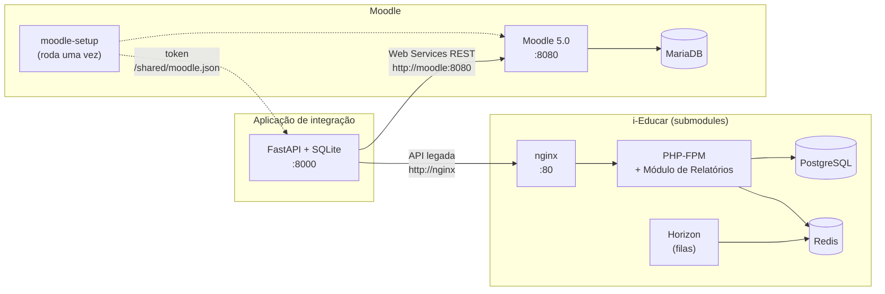
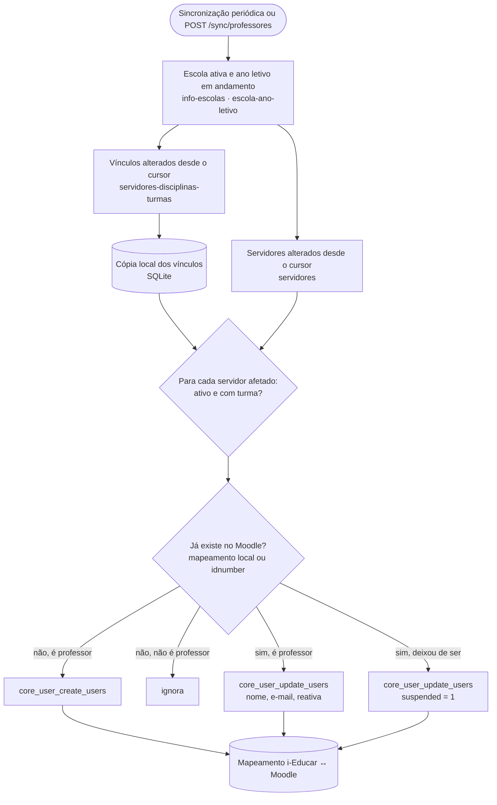
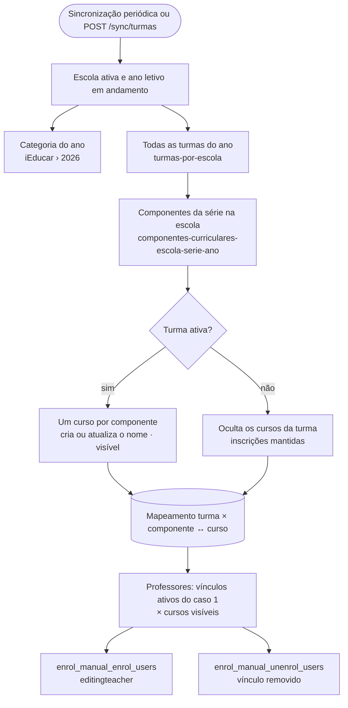

# i-Educar ↔ Moodle Integration

Aplicação de integração em **FastAPI** entre dois monólitos educacionais de código aberto: o
[i-Educar](https://github.com/portabilis/i-educar) (gestão escolar, fonte da verdade) e o
[Moodle](https://moodle.org/) (ambiente virtual de aprendizagem).

Todo o ambiente sobe com um único `docker compose`: i-Educar, Moodle, a aplicação de
integração e as dependências de cada um, conectados na mesma rede.

## Arquitetura



| Serviço        | Imagem / origem                                                         | Porta no host   |
|----------------|-------------------------------------------------------------------------|-----------------|
| `integration`  | `Dockerfile` deste repositório (Python 3.14)                            | `8000`          |
| i-Educar       | submodule `i-educar` (tag `2.11.0`) + Módulo de Relatórios (submodule `i-educar-reports`, branch `2.11`) | `80` / `443` |
| `moodle`       | `bitnamilegacy/moodle:5.0.2`                                            | `8080` / `8443` |
| `moodle-setup` | mesma imagem do Moodle; executa `moodle/setup_webservice.php` e termina | —               |
| `moodle-mariadb` | `bitnamilegacy/mariadb:11.8.3`                                        | —               |
| PostgreSQL / Redis | definidos pelo compose do i-Educar                                  | `5432` / `6379` |

O `moodle-setup` prepara o Moodle a cada `up` (idempotente): habilita os Web Services REST,
cria o serviço externo "iEducar Integration" com as funções usadas, a categoria `iEducar` e
o token, e grava token e IDs em `/shared/moodle.json`, de onde a aplicação os lê.

## Regras da integração

| i-Educar | Moodle | Situação |
|---|---|---|
| Servidor ativo com vínculo ativo com turma no ano letivo | **Usuário** (`idnumber` `ieducar-servidor-<id>`) | ✅ caso 1 |
| Turma × componente curricular | Um **curso** (`idnumber` `ieducar-turma-<turma>-componente-<componente>`) | ✅ caso 2 |
| Vínculo professor ↔ turma e componentes | Inscrição como `editingteacher` nos cursos dos componentes | ✅ caso 2 |
| Aluno enturmado (exceto componentes de que está dispensado) | Inscrição como aluno nos cursos da turma | planejado (caso 3) |

Os cursos ficam em categorias por ano letivo (`iEducar › 2026`). O papel de professor é
atribuído **no curso**, nunca na categoria inteira; por isso o caso 1 só cria e mantém o
usuário, e o caso 2 faz as inscrições.

### Caso 1 — professores (implementado)

Professor é o **servidor ativo com pelo menos um vínculo ativo com turma** no ano letivo em
andamento da escola. Servidores sem turma (secretaria, direção etc.) não vão para o Moodle.



- **Identidade:** o vínculo com o i-Educar fica no `idnumber` do usuário do Moodle e não
  depende de CPF ou e-mail. O login é o CPF (só números) ou `servidor<id>` sem CPF.
- **Leitura incremental:** a API do i-Educar aceita `modified`; a integração guarda um
  cursor por tipo de dado. Como o i-Educar grava datas ora em UTC (código legado), ora no
  fuso da aplicação (models Laravel), o cursor é recuado por `SYNC_CURSOR_OVERLAP_HOURS`.
- **Remoções:** vínculo excluído no i-Educar (ou servidor desativado ou removido) suspende
  o usuário; um novo vínculo o reativa. Usuários nunca são apagados. A cada execução, quem
  está ativo no Moodle sem turma no ano letivo também é suspenso, o que cobre a troca de
  ano letivo e vínculos transferidos para outro servidor.
- **Contas existentes:** se já houver no Moodle um usuário sem `idnumber` com o login do
  servidor, ele passa a ser mantido pela integração. Se o e-mail do servidor já pertencer
  a outro usuário do Moodle, usa-se o e-mail provisório.
- **Falhas:** um servidor que falha não interrompe os demais e é reavaliado na próxima
  execução. `completo=true` reenvia todos os servidores ao Moodle, desfazendo alterações
  feitas direto nele (e recriando usuários excluídos lá).

**Decisões e limitações**
- **Todo professor é `editingteacher`.** Nenhum endpoint do i-Educar expõe a função
  exercida na turma (docente, auxiliar…), então não há como distinguir `editingteacher` de
  `teacher`; todos os vinculados entram como `editingteacher`.
- **Vínculos sem componentes curriculares ficam fora do escopo.** A API de vínculos só
  devolve vínculos com componentes (o SQL faz `INNER JOIN` com os componentes da série).
  Para a função *Docente* a tela do i-Educar exige componentes — inclusive no professor
  unidocente, que marca todos —, mas funções como *Intérprete de LIBRAS* podem não ter;
  esses vínculos não são vistos pela integração e foram deixados de fora.
- O usuário é criado com `createpassword`, mas não há servidor de e-mail configurado: a
  senha precisa ser redefinida pelo administrador do Moodle.

### Caso 2 — turmas e componentes curriculares (implementado)

No i-Educar uma turma reúne alunos, professores e vários componentes curriculares; no
Moodle cada par **turma × componente** vira um curso. Exemplo: a turma "1º ano A" com
Português, Matemática e Ciências vira três cursos, cada um com o seu professor.



- **Quando o curso é criado:** para todo componente que a escola oferece na série da turma
  (Séries da escola), mesmo sem professor vinculado. Turmas multisseriadas reúnem os
  componentes de todas as suas séries.
- **Identificação:** `idnumber` `ieducar-turma-<turma>-componente-<componente>`, nome curto
  `<ano>-T<turma>-C<componente>` e nome completo `<turma> – <componente> (<ano>)`.
- **Estado desejado:** cada execução lê todas as turmas do ano (uma chamada, mais uma por
  série) e só envia ao Moodle o que difere do que a integração já criou.
- **Turma desativada ou componente retirado da série:** o curso é ocultado (`visible = 0`)
  e suas inscrições não são alteradas, para preservar o histórico. Reativar a turma volta
  a exibir o curso.
- **Professores:** inscritos como `editingteacher` nos cursos dos componentes dos seus
  vínculos ativos e desinscritos quando o vínculo sai. Usa os usuários e a cópia local dos
  vínculos mantidos pelo caso 1, por isso a sincronização periódica roda professores antes
  de turmas. Só as inscrições feitas pela integração são desfeitas; as criadas à mão no
  Moodle não são tocadas.
- **Limitação:** componentes definidos só para uma turma específica ("componentes
  curriculares diferenciados" no cadastro da turma) não são considerados; os cursos seguem
  os componentes da série na escola.

## Pré-requisitos

- [Docker](https://docs.docker.com/get-docker/) com Docker Compose v2.20+ (usa `include`)
- [Git](https://git-scm.com/)
- [uv](https://docs.astral.sh/uv/) (apenas para desenvolver a aplicação fora do container)

## Como executar

**1. Clone com os submodules**

```bash
git clone --recurse-submodules https://github.com/vargasnico/ieducar-moodle-integration.git
cd ieducar-moodle-integration
```

Se já clonou sem os submodules: `git submodule update --init`.

**2. Crie o `.env` do i-Educar**

```bash
cp i-educar/.env.example i-educar/.env
```

**3. Suba os containers**

```bash
docker compose up -d --build
```

A primeira inicialização do Moodle leva alguns minutos; acompanhe com
`docker compose logs -f moodle`. A aplicação só sobe depois que o `moodle-setup` termina.

**4. Instale o i-Educar (apenas na primeira vez)**

```bash
docker compose exec -u root php sh -c "find bootstrap/cache storage -type d -exec chmod 777 {} +"
docker compose exec php composer config --global preferred-install.cossou/jasperphp source
docker compose exec php composer new-install
docker compose exec php php artisan db:seed
docker compose exec php php artisan community:reports:install
docker compose exec php php artisan vendor:publish --tag=reports-assets --ansi
```

> - O `chmod` evita erros de permissão em volumes montados no Windows.
> - O `composer config` faz a dependência do Módulo de Relatórios (`cossou/jasperphp`, que traz
>   o JasperStarter) ser instalada via `git clone`. Instalada pelo `.zip`, a extração falha no
>   Windows com `Could not delete .../JasperStarter/lib`.
> - O `new-install` já ativa o Módulo de Relatórios (via `composer plug-and-play`), pois o
>   submodule `i-educar-reports` é montado em `i-educar/packages/portabilis/` pelo
>   `ieducar.override.yml`. Os dois últimos comandos instalam os menus e os arquivos dele.
>   Sem o módulo, o cadastro de turmas do i-Educar quebra
>   (`Class "Portabilis_Model_Report_TipoBoletim" not found`).

**5. (Opcional) Dados de teste**

```bash
docker compose exec php php artisan db:seed --class=DemoSeeder
docker compose exec -T php sh -c "cat > /tmp/seed.php" < scripts/ieducar_seed_professores.php
docker compose exec php php artisan tinker --execute="require '/tmp/seed.php';"
```

O `DemoSeeder` do i-Educar cria escolas, cursos, séries, turmas e alunos. O script
[`scripts/ieducar_seed_professores.php`](scripts/ieducar_seed_professores.php) cria quatro
servidores, um por situação da regra de professores:

| Servidor | Função | Turma | Resultado esperado no Moodle |
|---|---|---|---|
| Ana Paula Souza | Professor | 1 turma, 2 componentes | usuário criado |
| Bruno Lima | Professor | 1 turma, todos os componentes (unidocente) | usuário criado |
| Carla Mendes | Secretário escolar | — | não entra |
| Diego Rocha | Professor | — | não entra |

Depois rode `POST /sync/professores?completo=true` e `POST /sync/turmas` (ou aguarde a
sincronização periódica). Com o `DemoSeeder` são criados 177 cursos (21 turmas × os
componentes de cada série), e Ana e Bruno são inscritos como professores nos cursos dos
componentes que lecionam.

## Acessos

| Sistema            | URL                         | Credenciais padrão    |
|--------------------|-----------------------------|-----------------------|
| Integração (docs)  | http://localhost:8000/docs  | —                     |
| i-Educar           | http://localhost            | `admin` / `123456789` |
| Moodle             | http://localhost:8080       | `admin` / `admin123`  |

### Endpoints da integração

| Método | Rota | Descrição |
|---|---|---|
| `GET`  | `/health` | Aplicação no ar |
| `GET`  | `/health/dependencias` | Autenticação no i-Educar e no Moodle; escolas ativas e ano letivo |
| `POST` | `/sync/professores?completo=false` | Sincronização manual; `completo=true` ignora os cursores e reenvia todos ao Moodle |
| `POST` | `/sync/turmas?completo=false` | Cursos de turma × componente e inscrição de professores; `completo=true` reenvia todos ao Moodle |
| `GET`  | `/sync/execucoes` | Histórico das execuções (manuais e agendadas) |
| `GET`  | `/professores` | Mapeamento servidor do i-Educar ↔ usuário do Moodle |
| `GET`  | `/cursos?ano=` | Mapeamento turma × componente do i-Educar ↔ curso do Moodle |

## Configuração

Variáveis da aplicação de integração (serviço `integration` no `docker-compose.yml`):

| Variável | Padrão | Descrição |
|---|---|---|
| `IEDUCAR_ACCESS_KEY` | `ieducar-access-key` | Chave da API do i-Educar. Deve ser igual a "Chave de acesso" em Configurações › Configurações do sistema (tabela `settings`, `legacy.apis.access_key`) |
| `IEDUCAR_INSTITUICAO_ID` | `1` | Instituição no i-Educar |
| `IEDUCAR_ESCOLA_ID` | — | Escola a sincronizar. Sem valor, usa as escolas ativas |
| `IEDUCAR_ANO_LETIVO` | — | Ano letivo. Sem valor, usa o ano em andamento da escola |
| `SYNC_INTERVAL_SECONDS` | `300` | Intervalo da sincronização periódica; `0` desativa |
| `SYNC_CURSOR_OVERLAP_HOURS` | `24` | Margem de releitura das consultas incrementais |
| `MOODLE_TOKEN` | — | Sobrescreve o token gerado pelo `moodle-setup` |

Variáveis do ambiente, que podem ficar num `.env` na raiz do projeto:

| Variável                     | Padrão               |
|------------------------------|----------------------|
| `API_PORT`                   | `8000`               |
| `MOODLE_HTTP_PORT`           | `8080`               |
| `MOODLE_HTTPS_PORT`          | `8443`               |
| `MOODLE_USERNAME`            | `admin`              |
| `MOODLE_PASSWORD`            | `admin123`           |
| `MOODLE_EMAIL`               | `admin@example.com`  |
| `MOODLE_SITE_NAME`           | `Moodle`             |
| `MOODLE_DATABASE_USER`       | `bn_moodle`          |
| `MOODLE_DATABASE_PASSWORD`   | `moodle`             |
| `MOODLE_DATABASE_NAME`       | `bitnami_moodle`     |

As configurações do i-Educar (portas, banco, etc.) ficam em `i-educar/.env`.

## Desenvolvimento

Com hot reload dentro do Docker:

```bash
docker compose watch
```

Ou localmente, fora do container:

```bash
uv sync
uv run fastapi dev src/app/main.py
```

Lint e checagem de tipos:

```bash
uv run ruff check .
uv run ty check
```

## Estrutura

```
.
├── src/app/
│   ├── main.py               # FastAPI: rotas e agendador
│   ├── config.py             # Variáveis de ambiente e dados do moodle-setup
│   ├── db.py                 # SQLite: mapeamentos, vínculos, cursores, execuções
│   ├── clients/ieducar.py    # Cliente da API legada do i-Educar
│   ├── clients/moodle.py     # Cliente dos Web Services REST do Moodle
│   └── sync/
│       ├── contexto.py       # Escola e ano letivo da execução
│       ├── professores.py    # Caso 1: servidores com turma → usuários
│       ├── turmas.py         # Caso 2: turma × componente → cursos e inscrições
│       └── service.py        # Trava, histórico de execuções e agendamento
├── moodle/setup_webservice.php   # Preparação do Moodle (serviço moodle-setup)
├── scripts/                  # Dados de teste
├── i-educar/                 # Submodule do i-Educar (tag 2.11.0)
├── i-educar-reports/         # Submodule do Módulo de Relatórios do i-Educar (branch 2.11)
├── Dockerfile                # Imagem da aplicação de integração
├── docker-compose.yml        # Orquestração: integração + i-Educar + Moodle
└── ieducar.override.yml      # Ajustes sobre o compose do i-Educar
```

## Solução de problemas

- **Horizon em restart loop (`env: can't execute 'php'`)** — causado por quebras de linha
  CRLF no checkout do Windows. Já tratado pelo `ieducar.override.yml`; para evitar o
  problema em outros scripts, configure o submodule com
  `git -C i-educar config core.autocrlf false` antes do checkout.
- **Cadastro de turma com erro `Portabilis_Model_Report_TipoBoletim not found`** — o Módulo
  de Relatórios não está ativo. Confira se o submodule `i-educar-reports` foi baixado
  (`git submodule update --init`) e rode `composer plug-and-play`,
  `artisan community:reports:install` e `vendor:publish --tag=reports-assets` no container `php`.
- **`Chave de acesso inválida!` em `/health/dependencias`** — `IEDUCAR_ACCESS_KEY` difere da
  chave configurada no i-Educar (Configurações › Configurações do sistema).
- **`Nenhuma escola ativa` / `Nenhum ano letivo em andamento`** — cadastre a escola e inicie
  o ano letivo no i-Educar, ou carregue o `DemoSeeder`.
- **Portas em uso** — altere `DOCKER_NGINX_PORT`, `DOCKER_POSTGRES_PORT` etc. em
  `i-educar/.env`, ou as variáveis da tabela acima.

## Autores

- Francisco Rotilli — [francisco.r@edu.pucrs.br](mailto:francisco.r@edu.pucrs.br)
- Nícolas Durgante Vargas — [nicolas.v02@edu.pucrs.br](mailto:nicolas.v02@edu.pucrs.br)
