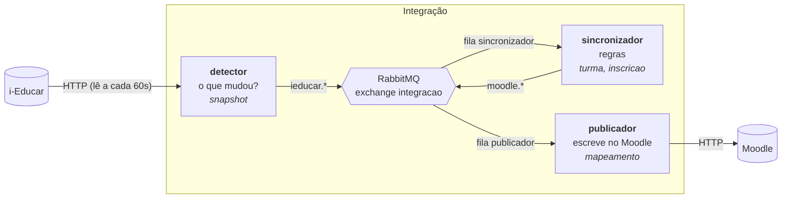

# Arquitetura do T2

A integração i-Educar → Moodle do T1, refeita como três serviços que se comunicam por
mensagens no RabbitMQ. As decisões estão nas ADRs:
[decomposição](adr/0001-decomposicao.md), [comunicação](adr/0002-comunicacao.md),
[resiliência](adr/0003-resiliencia.md), [stack](adr/0004-stack.md) e
[repositórios e deploy](adr/0005-repositorios-e-deploy.md). Os cenários de
falha estão em [failure-scenarios.md](failure-scenarios.md).

## Visão geral



| Serviço | Porta | O que faz | Banco próprio | Repositório |
|---|---|---|---|---|
| detector | 8001 | A cada 60s lê o ano letivo no i-Educar, compara cada servidor, turma e aluno com o último estado publicado (hash) e publica um evento para cada um que mudou | `snapshot` | `ieducar-moodle-detector` ([`servicos/detector`](../servicos/detector)) |
| sincronizador | 8002 | Aplica as regras do T1 a cada evento e publica os comandos para o Moodle | `turma`, `inscricao` | `ieducar-moodle-sincronizador` ([`servicos/sincronizador`](../servicos/sincronizador)) |
| publicador | 8003 | Aplica cada comando no Moodle procurando antes de criar (idempotente), com timeout e retry | `mapeamento` | `ieducar-moodle-publicador` ([`servicos/publicador`](../servicos/publicador)) |

Cada serviço fica no **próprio repositório**, com dependências, testes, Dockerfile,
versão e CI próprios, e entra aqui como git submodule em `servicos/`. Não há código
compartilhado: o contrato entre eles é o formato das mensagens (catálogo abaixo).
Este repositório (`ieducar-moodle-integration`) é o de **orquestração**: o
`docker-compose.yml`, a topologia do RabbitMQ (`infra/rabbitmq/definitions.json`),
o i-Educar, o Moodle, a documentação e os cenários de falha
([ADR 0005](adr/0005-repositorios-e-deploy.md)).

```
ieducar-moodle-integration/        (orquestração)
├── docker-compose.yml             sobe tudo
├── infra/rabbitmq/                exchange, filas, retry e DLQ (carregados ao subir)
├── servicos/detector/       ──▶   repositório ieducar-moodle-detector (submodule, v1.0.0)
├── servicos/sincronizador/  ──▶   repositório ieducar-moodle-sincronizador (submodule, v1.0.0)
├── servicos/publicador/     ──▶   repositório ieducar-moodle-publicador (submodule, v1.0.0)
├── i-educar/, moodle/             sistemas integrados
└── docs/, scripts/                arquitetura e cenários de falha
```

## Uma sincronização

1. **Detector:** lê turmas, servidores e alunos do ano letivo e calcula um hash do
   estado de cada um. Publica `ieducar.<tipo>.alterado.v1` para os que mudaram (todos,
   com `POST /ciclos?completo=true`) e `ieducar.<tipo>.removido.v1` para os que
   sumiram. Depois grava o snapshot. Todas as mensagens do ciclo levam o mesmo
   `correlation_id`.
2. **Sincronizador:** consome um evento por vez, aplica as regras
   ([`regras.py`](../servicos/sincronizador/src/sincronizador/regras.py)) e publica comandos de estado
   desejado: o usuário, os cursos e as inscrições a adicionar e a remover.
3. **Publicador:** consome até 10 comandos em paralelo. Para usuários e cursos,
   procura pelo `idnumber` e atualiza ou cria; para inscrições, busca os ids e
   inscreve. Se a inscrição chegar antes do usuário ou do curso existir, ela falha e
   volta pela fila de retry.

```
detector ── ieducar.aluno.alterado.v1 ──▶ sincronizador ── moodle.usuario.sincronizar.v1 ──▶ publicador ──▶ Moodle
                                                        └─ moodle.inscricao.adicionar.v1 (×9) ──┘
```

Com o seed do `setup.sh`, um ciclo completo publica 235 eventos (21 turmas, 4
servidores, 210 alunos), que viram ~2.170 comandos.

## Filas

| Fila | Recebe (routing key) | Consumidor | Auxiliares |
|---|---|---|---|
| `sincronizador` | `ieducar.#` | sincronizador (1 por vez, na ordem) | `sincronizador.retry`, `sincronizador.dlq` |
| `publicador` | `moodle.#` | publicador (até 10 em paralelo) | `publicador.retry`, `publicador.dlq` |

`*.retry` não tem consumidor: a mensagem espera 10s (TTL) e volta para a fila
principal. Depois de 5 falhas ela vai para `*.dlq`, e `POST /dlq/reprocessar` a
devolve à fila. A topologia é criada quando o RabbitMQ sobe
(`infra/rabbitmq/definitions.json`), e cada consumidor também declara a própria fila.
Filas e mensagens são duráveis e sobrevivem a um reinício do
RabbitMQ. Interface do RabbitMQ: http://localhost:15672 (`integracao` / `integracao`).

## Catálogo de mensagens

Todas as mensagens têm o mesmo formato JSON (`mensagem.py`, com uma cópia em cada
serviço):

| Campo | Significado |
|---|---|
| `id` | UUID da mensagem |
| `tipo`, `versao` | nome e versão; a routing key é `<tipo>.v<versao>` |
| `correlation_id` | a sincronização (ciclo do detector) a que a mensagem pertence; passa do evento para os comandos |
| `ciclo_iniciado_em` | quando o ciclo começou (usado na métrica de tempo de sincronização) |
| `ocorrido_em` | quando a mensagem foi criada |
| `dados` | conteúdo, conforme o tipo (tabelas abaixo) |

```json
{
  "id": "0b8e5c1e-…",
  "tipo": "ieducar.aluno.alterado",
  "versao": 1,
  "correlation_id": "6523ebed-f80c-4cd6-a81e-38098a014c7d",
  "ciclo_iniciado_em": "2026-11-22T16:30:01.120Z",
  "ocorrido_em": "2026-11-22T16:30:03.512Z",
  "dados": {
    "aluno_id": 10, "nome": "Daniele Batista Azevedo", "ativo": true,
    "turmas": [{"turma_id": 3, "componentes": [8, 9, 10, 11, 12, 13, 14, 15, 16]}]
  }
}
```

### Eventos do detector (estado atual da entidade no i-Educar)

| Routing key | `dados` |
|---|---|
| `ieducar.turma.alterada.v1` | `turma_id`, `nome`, `ano`, `ativa`, `componentes: [{id, nome}]` (componentes das séries da turma) |
| `ieducar.servidor.alterado.v1` | `servidor_id`, `nome`, `cpf`, `email`, `ativo`, `vinculos: [{turma_id, componentes: [id]}]` (vínculos ativos do ano) |
| `ieducar.aluno.alterado.v1` | `aluno_id`, `nome` (nome social, se houver), `ativo`, `turmas: [{turma_id, componentes: [id]}]` (componentes da série sem os dispensados) |
| `ieducar.turma.removida.v1` · `ieducar.servidor.removido.v1` · `ieducar.aluno.removido.v1` | `turma_id` · `servidor_id` · `aluno_id` (saiu do ano letivo) |

### Comandos do sincronizador (estado desejado no Moodle)

| Routing key | `dados` |
|---|---|
| `moodle.usuario.sincronizar.v1` | `idnumber` (`ieducar-servidor-<id>` ou `ieducar-aluno-<id>`), `username`, `firstname`, `lastname`, `email`, `suspenso` (num removido, só `idnumber` e `suspenso`) |
| `moodle.curso.sincronizar.v1` | `idnumber` (`ieducar-turma-<turma>-componente-<componente>`), `shortname`, `fullname`, `ano`, `visivel` |
| `moodle.inscricao.adicionar.v1` | `usuario`, `curso` (idnumbers), `papel` (`editingteacher` ou `student`) |
| `moodle.inscricao.remover.v1` | `usuario`, `curso`, `papel` |

## Observabilidade

- **Logs estruturados:** JSON, uma linha por evento, com `ts`, `nivel`, `servico`,
  `msg` e `correlation_id`. Para seguir uma sincronização pelos três serviços:
  `docker compose logs detector sincronizador publicador | grep <correlation_id>`.
- **Health check:** `GET /health` em cada serviço responde 200 se ele está no ar e
  conectado ao RabbitMQ, e 503 se não.
- **Métricas** (`GET /metrics`, formato Prometheus):
  - `mensagens_total{servico,tipo,resultado}`: mensagens processadas com
    `sucesso`, que foram para `retry` ou para a `dlq`;
  - `detector_ciclos_total{resultado}` e `detector_eventos_total{tipo}`: ciclos (com
    sucesso ou falha) e mudanças detectadas;
  - `detector_ciclo_segundos`: duração da leitura do i-Educar;
  - `sincronizacao_segundos{tipo}`: tempo do início do ciclo até o comando ser
    aplicado no Moodle.

## Comparação com o T1

| | T1 (monólito) | T2 (microsserviços) |
|---|---|---|
| Processos | 1 (FastAPI + SQLite) | 3 serviços + RabbitMQ, cada serviço com o seu SQLite |
| Código e deploy | 1 repositório, 1 imagem | 1 repositório, 1 imagem e 1 versão por serviço; um serviço é atualizado sem mexer nos outros |
| Comunicação | Chamadas de função | Eventos e comandos versionados no RabbitMQ |
| Detectar mudanças | Cada caso lia tudo e comparava com o mapeamento local | Um serviço só para isso: compara o hash do estado com o snapshot e publica só o que mudou |
| Ordem entre os casos | Fixa: professores → turmas → alunos | Detector publica turmas primeiro; o que chegar antes da hora volta pela fila de retry |
| Moodle fora do ar | A execução falhava; tudo era refeito na próxima | Os comandos esperam na fila (retry a cada 10s, DLQ depois de 5 falhas); detector e sincronizador continuam |
| i-Educar fora do ar | A execução falhava | O ciclo falha sem publicar nada; o próximo encontra tudo o que mudou |
| Timeout / retry | 30s / nenhum | 3s+10s / 3 tentativas com backoff + fila de retry + DLQ |
| Resposta perdida após criar | "Procurar antes de criar", mas o item ficava com erro até a próxima execução | O mesmo "procurar antes de criar", dentro do retry: resolve na hora |
| Reinício no meio | A execução era perdida | Ack manual: as mensagens não confirmadas voltam e são tratadas de novo, sem duplicar |
| Observabilidade | Logs de texto, histórico de execuções | Logs JSON com correlation ID, `/health` e `/metrics` em cada serviço |

As regras de negócio são as mesmas do T1 (README, "Regras da integração").

## Limitações

- **Sem circuit breaker** (desejável no enunciado) e **sem tracing distribuído**; o
  correlation ID nos logs faz o papel do rastreamento.
- **Ordem:** se uma mensagem passar pela fila de retry, uma versão mais nova da mesma
  entidade pode ser aplicada antes dela. Um ciclo completo corrige.
- **Uma instância por serviço** (SQLite).
- Diferente do T1, as inscrições de cursos ocultos não são preservadas
  automaticamente: um aluno que sai da turma é desinscrito mesmo que o curso esteja
  oculto.
